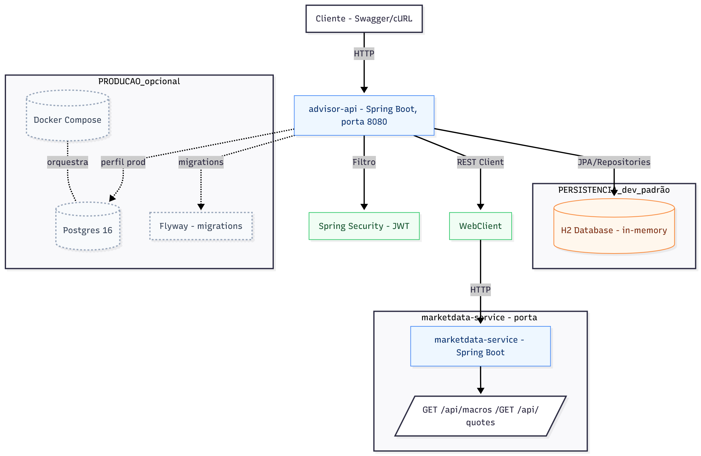

# Sprint 4 — Arquitetura Orientada a Serviços e Web Services (SOA/WS)

## Integrantes
- Aksel Viktor Caminha Rae – RM99011  
- Ian Xavier Kuraoka – RM98860  
- Arthur Wollmann Petrin – RM98735  
- Miguel Ruan de Souza – RM551239  

---

## Descrição do Projeto
Este projeto demonstra uma arquitetura orientada a serviços (SOA) utilizando Web Services RESTful com dois microserviços independentes que se comunicam via HTTP.

A aplicação principal (**advisor-api**) fornece recomendações de investimentos, consumindo dados de mercado expostos por um serviço auxiliar (**marketdata-service**).  
A comunicação entre os serviços é feita via HTTP utilizando o componente **WebClient**, e a autenticação é baseada em **JWT**.

---

## Estrutura dos Serviços

| Serviço | Porta | Descrição |
|----------|--------|-----------|
| advisor-api | 8080 | Serviço principal responsável por autenticação, cadastro de clientes, ativos e geração de recomendações. |
| marketdata-service | 8081 | Serviço secundário responsável por fornecer dados macroeconômicos, como dólar, inflação e taxa SELIC. |

---

## Diagrama da Arquitetura



---

## Tecnologias Utilizadas
- Java 17  
- Spring Boot 3  
- Spring Web e WebClient  
- Spring Security (JWT)  
- Spring Data JPA  
- H2 Database  
- Swagger UI  
- Maven  

---

## Como Executar o Projeto

1. Abrir dois terminais.  
2. No primeiro terminal, executar o serviço de dados de mercado:
   ```bash
   cd services/marketdata-service
   mvn spring-boot:run
   ```
3. No segundo terminal, executar o serviço principal:
   ```bash
   cd services/advisor-api
   mvn spring-boot:run
   ```
4. Acessar o Swagger em:
   ```
   http://localhost:8080/swagger-ui/index.html
   ```

---

## Testes com cURL

### Registrar usuário
```bash
curl -X POST http://localhost:8080/api/auth/register -H "Content-Type: application/json" -d "{\"name\":\"Ana\",\"email\":\"ana@facul.edu\",\"password\":\"123456\"}"
```

### Login e obter token
```bash
curl -X POST http://localhost:8080/api/auth/login -H "Content-Type: application/json" -d "{\"email\":\"ana@facul.edu\",\"password\":\"123456\"}"
```

### Criar cliente
```bash
curl -X POST http://localhost:8080/api/clients -H "Authorization: Bearer <TOKEN>" -H "Content-Type: application/json" -d "{\"name\":\"Maria\",\"riskProfile\":\"CONSERVADOR\",\"liquidity\":15000}"
```

### Criar ativo
```bash
curl -X POST http://localhost:8080/api/assets -H "Authorization: Bearer <TOKEN>" -H "Content-Type: application/json" -d "{\"ticker\":\"TESOURO\",\"assetClass\":\"RENDA_FIXA\",\"risk\":0.05,\"expReturn\":0.11}"
```

### Gerar recomendação
```bash
curl -X POST http://localhost:8080/api/recommendations/generate -H "Authorization: Bearer <TOKEN>" -H "Content-Type: application/json" -d "{\"clientId\":1,\"goal\":\"aposentadoria\",\"horizonYears\":20}"
```

---

## Conclusão
O projeto apresenta uma implementação prática dos princípios de Arquitetura Orientada a Serviços (SOA) e Web Services, aplicando autenticação JWT, comunicação entre microserviços via REST e persistência em banco de dados relacional.
